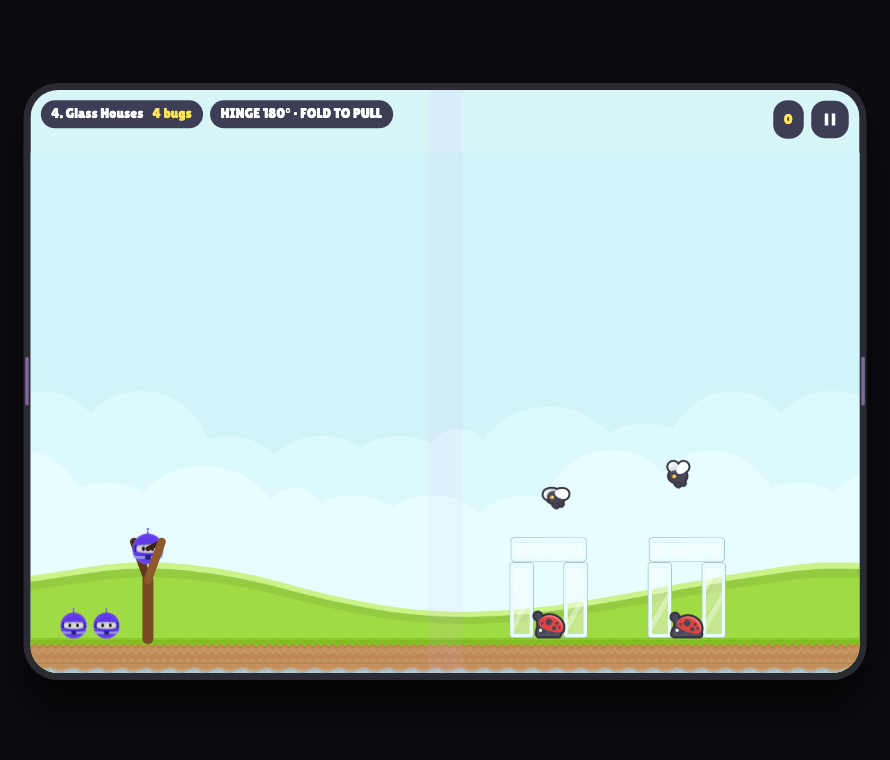
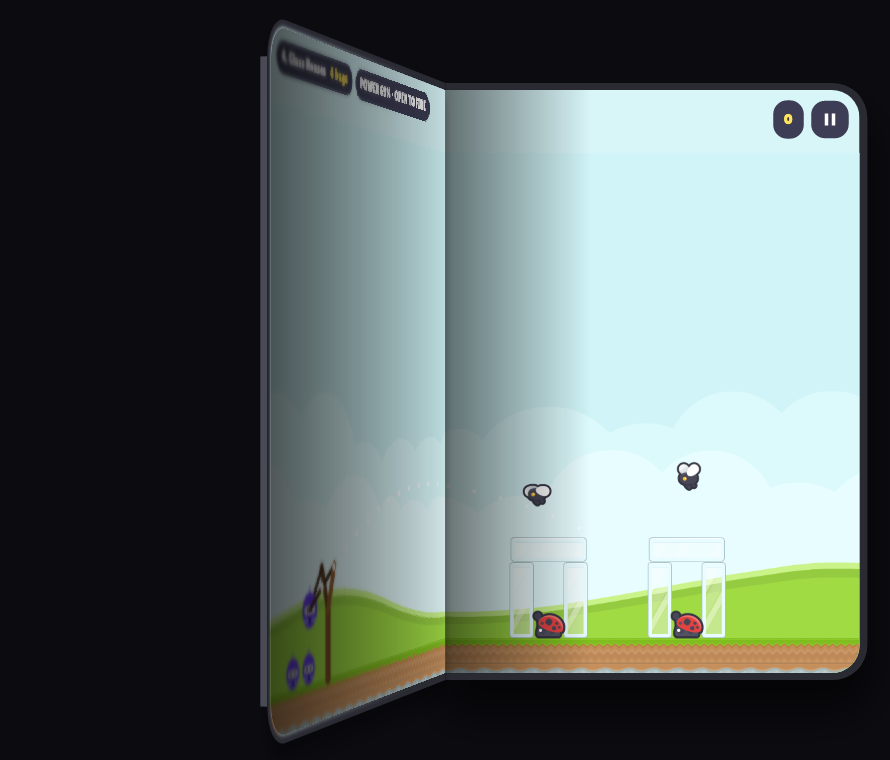
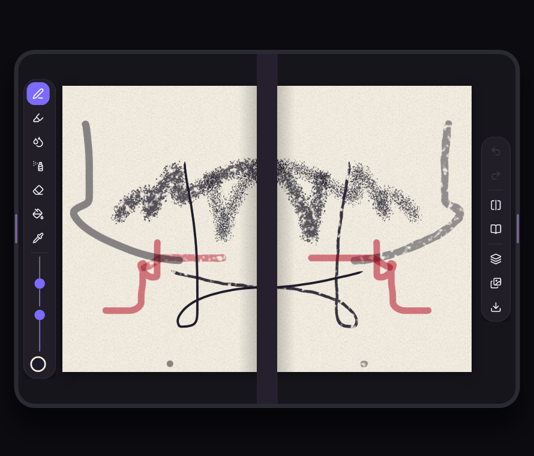
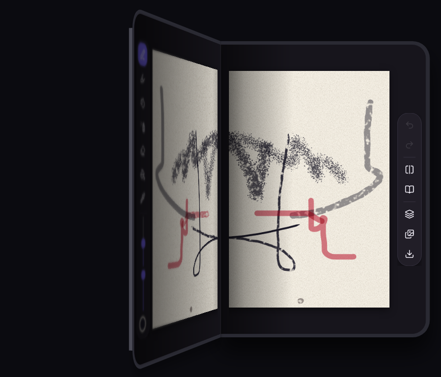
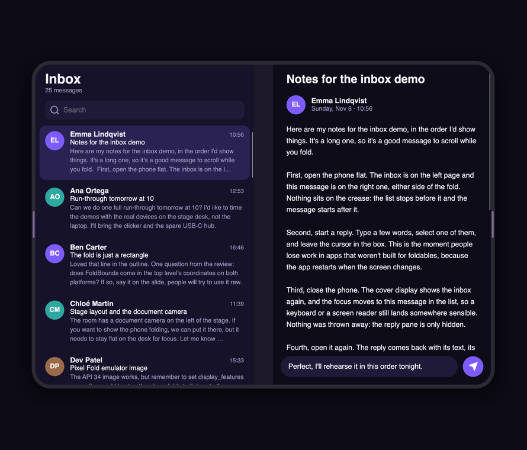
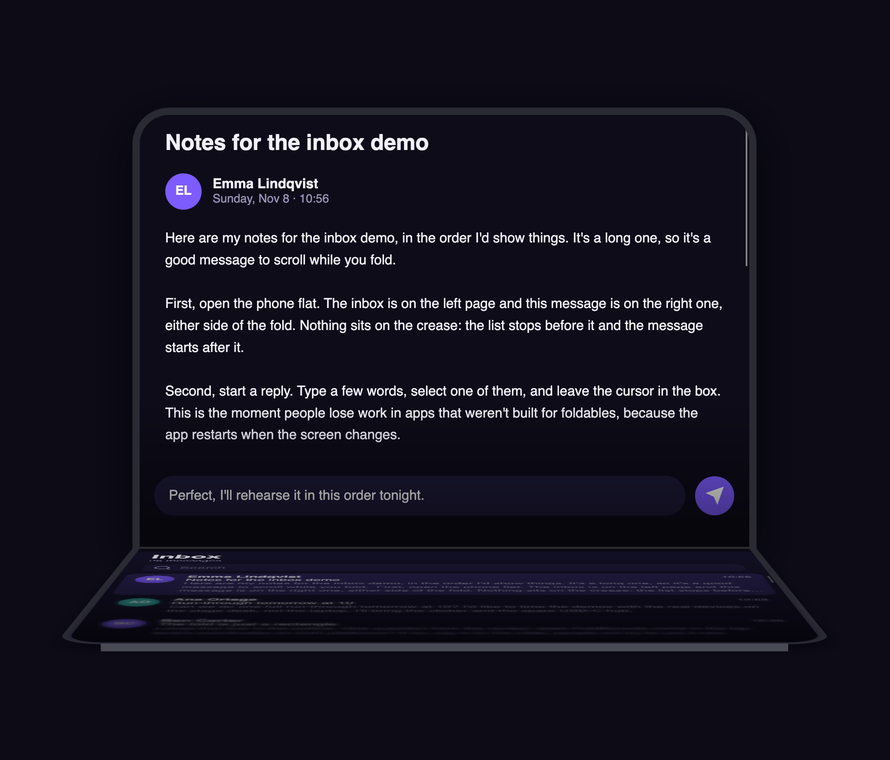

# Unfold your UI

Building awesome foldable apps with .NET and Avalonia. This is the material from my .NET Conf 2026 session: the slides and two apps made for it.

Foldables stopped being a niche this year. The iPhone Duo is in stores, and Android 17 no longer lets large-screen apps opt out of resizing. The session covers the four postures, why the fold is just a rectangle, and how [Nova.Avalonia.Foldable](https://github.com/jsuarezruiz/Nova.Avalonia.Foldable) brings it to Avalonia from one shared codebase.

The slides are in [Unfold Your UI Foldable Apps with .NET and Avalonia.pptx](Unfold%20Your%20UI%20Foldable%20Apps%20with%20.NET%20and%20Avalonia.pptx), with speaker notes, and as a [PDF](Unfold%20Your%20UI%20Foldable%20Apps%20with%20.NET%20and%20Avalonia.pdf). They use the .NET Conf 2026 template, which embeds its fonts in the .pptx; to present from Keynote, install Space Grotesk, Open Sans and Cascadia Code first. They come in four parts: core concepts, the library, eleven samples (both apps below among them), and tips for keeping users where they were when the device folds.

## Bot vs Bugs

Launch the dotnet bot at the bugs before they ship. Drag it back on the sling, or fold the phone to pull it and snap it open to fire. Laid flat, the game spans both screens. In tabletop, the bottom half becomes a control deck.

 

## Inkfold

A sketchbook for a phone that folds. The page opens across the fold like a book. Arm the press, close the phone and open it again, and the wet paint prints onto the facing page.

 

## Inbox

The talk's tips as an app: the list and the open message either side of the fold. Search, start a reply, close the phone and open it again, and everything comes back: the message, the search and its results, the draft with its cursor and selection, the focus, and the place you were reading. On the cover display a message opens on its own, and the back button, Android's back or a swipe from the left edge returns to the list.

 

## Run them

You need .NET SDK 10.0.402 with the iOS and Android workloads, and Xcode 27.1 for iOS. Clone with the library, which comes in as a submodule until it's on NuGet:

```bash
git clone --recursive https://github.com/jsuarezruiz/dotnetconf2026-avalonia-foldables.git
dotnet run --project src/BotVsBugs/BotVsBugs.Desktop
```

Swap in `Inkfold` or `Inbox` for the other apps, or build the `.iOS` and `.Android` heads for a device. Without the mobile workloads, add `-p:DesktopOnly=true` so the library builds for desktop only. [STATUS.md](STATUS.md) lists what's been tested where.

The fold logic, the game rules and the inbox's folds have tests that run without a device:

```bash
dotnet test tests/DotnetConf2026.Foldable.Tests -p:DesktopOnly=true
```

The session's other demos, the Sample and Guide To the Stars, live in the [library's repo](https://github.com/jsuarezruiz/Nova.Avalonia.Foldable/tree/main/samples).

## Learn more

- [Nova.Avalonia.Foldable docs](https://jsuarezruiz.github.io/Nova.Avalonia.Foldable/): postures, `TwoPaneView`, testing without a device, and setting up the iPhone Duo simulator and the Pixel Fold emulator
- [Avalonia Vignettes](https://github.com/jsuarezruiz/avalonia_vignettes), where Guide To the Stars comes from

Reports from real foldables are welcome. I'm [@jsuarezruiz](https://github.com/jsuarezruiz) everywhere.

## Credits

Art from [Kenney](https://kenney.nl) (CC0), the [.NET bot](https://github.com/dotnet/brand) (CC0), the [Lilita One](https://fonts.google.com/specimen/Lilita+One) font (OFL), [Lucide](https://lucide.dev) icons (ISC) and [Aether.Physics2D](https://github.com/nkast/Aether.Physics2D) (MS-PL). The art, font and icon licenses are in [licenses](licenses). The code is [MIT](LICENSE).
